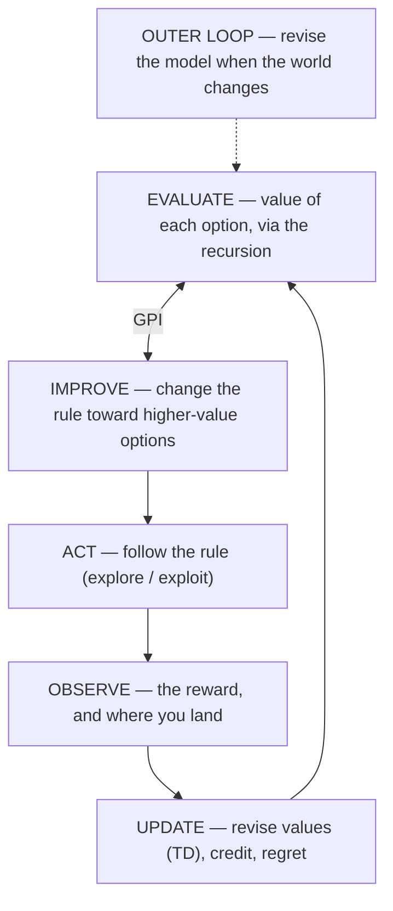
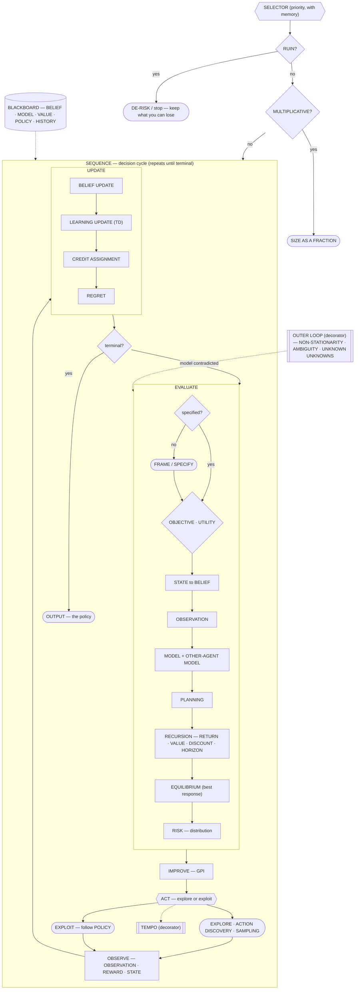

# RL Decision Framework (Human-Readable)

## The setting

Use this for any decision. The general setting is **multi-agent,
partially observable, and model-uncertain** — not the fully-known single-agent MDP textbooks start
from. Read the decision as a tuple:

- **AGENTS (N ≥ 1)** — one or more decision-makers. With N > 1 your value depends on the others'
  rules (and theirs on yours), so there is no unique optimal policy — only a **best response**.
  Single-agent is the N = 1 special case.
- **STATE** — the true situation. You never observe it directly.
- **OBSERVATION** — the partial, noisy, sometimes delayed signal you actually get.
- **BELIEF** — your distribution over the state (and, for N > 1, over the other agents).
- **ACTION** — your choices. The action set is itself uncertain and grows with search.
- **REWARD / UTILITY** — the payoff, valued through a concave utility (its curvature is risk aversion).
- **MODEL** — your belief about transitions, payoffs, and observations — and, for N > 1, about the
  other agents.
- **DISCOUNT (γ)** and **HORIZON** — how much later counts, and whether it ends.

Three axes set the difficulty: **how many agents**, **how little you observe**, and **how wrong your
model may be**. The textbook corner — one agent, fully observed, known model — is the *easiest* case,
not the norm.

The load-bearing pieces are: a **value separate from the rule**, a **recursion**, a **learning
update**, and **iteration to a fixed point (GPI)**.

The **global objective** is **Merton's**: maximize the expected **utility of consumption** over time
— discounted, and shaped by risk aversion — not raw reward, and not wealth.

## The loop



Run it in a loop. `EVALUATE ⇄ IMPROVE` (GPI) settles the rule; `ACT → OBSERVE → UPDATE` feeds it real
outcomes; the outer loop rebuilds the model when the world changes. With N > 1 the outer loop never
rests — other agents keep moving the world.

## The full state machine (stateful behaviour tree)

The diagram above is the six-phase summary; the tree below is the **full state machine**, with every
stage as a node. It is a **stateful behaviour tree**: a priority **selector** at the root (gates
first), a **sequence** for the cycle, **decorators** for tempo and the outer loop, **conditions** for
the gates and the terminal check, and **actions** for the stages. Its **state** is the blackboard —
BELIEF, MODEL, VALUE, POLICY, HISTORY — read and written by every node, which is what makes it a
behaviour tree *with state* rather than a pure function.

Legend: `{{ }}` selector · `[ ]` sequence · `{ }` condition · `([ ])` action · `[[ ]]` decorator · `[( )]` blackboard.



### State storage

One file **per decision** — not per project — so concurrent decisions never clobber each other. It is
saved in a **fixed format** so it survives across stages and delegated agents: **YAML with locked
keys**, at `.opencode/rl-decision/<id>.yaml`, where `<id>` is a short kebab-case slug of the objective
(falling back to a timestamp). Keys are never renamed, reordered, or added; `history` gains exactly one
entry per cycle. The orchestrator writes it after every stage; delegated agents read it.

```yaml
spec:    { decision: "", by: "", when: "", clear: true }
objective: ""
belief:  { state: "", uncertainty: "" }
model:   { transitions: "", rewards: "", observations: "", other_agents: null }
value:   { estimates: "", risk: "" }
policy:  ""
gates:   { ruin: "", multiplicative: "" }
history: []
```

## Which stages live in which phase

| Phase | What you do | Stages |
|---|---|---|
| **SPECIFY** | frame the decision; resolve anything unclear | AGENTS, STATE, ACTION, REWARD, MODEL, OBSERVATION, DISCOUNT, HORIZON |
| **EVALUATE** | revise how much each situation/option is worth | OBJECTIVE (constructs REWARD), STATE (specifies state), OBSERVATION, REWARD, UTILITY, RETURN, VALUE, DISCOUNT, MODEL, OTHER-AGENT MODEL, EQUILIBRIUM, HORIZON, RECURSION, RISK |
| **IMPROVE** | change the rule toward higher-value options | POLICY; GPI |
| **ACT** | follow the rule | ACTION; ACTION DISCOVERY; TEMPO; EXPLORE/EXPLOIT; SAMPLING; gates: RUIN, MULTIPLICATIVE |
| **OBSERVE** | see the result | OBSERVATION, REWARD, STATE |
| **UPDATE** | revise your estimates — values and beliefs | BELIEF UPDATE, LEARNING UPDATE (TD), CREDIT ASSIGNMENT, REGRET |
| **OUTER LOOP** | revise the model | NON-STATIONARITY (incl. other agents adapting), AMBIGUITY/ROBUSTNESS, UNKNOWN UNKNOWNS |

## Stages, defined

**SPECIFY** — before the loop, frame the decision: *what* is being decided, *by whom*, and *by when* —
and check the tuple is complete: **AGENTS** (who else acts), **STATE** (which variables), **ACTION**
(what's available), **REWARD** (what's maximized), **MODEL**, **OBSERVATION**, **DISCOUNT**,
**HORIZON**. If anything is unclear or missing, resolve it first — **ask the user** when only they
know, otherwise research or decompose; if everything is already clear, go straight on. *"Is the problem
fully specified — do I know what I'm deciding?"* **→ `decision-record`**

**STATE** — the situation you're in. You specify it here, in two parts: the **state space** — name the
variables that define the situation (resources, position, constraints; with N > 1, the others' state
too) — and the **current state**, which you never observe fully, so you act on a **BELIEF** — a
picture of the state's current values plus their uncertainty. Its *dynamics* live in MODEL.
*"Where am I?"*

**OBSERVATION** — what you actually get to see: partial, noisy, sometimes delayed — a signal *about*
the state, never the state itself. *"What do I actually see?"*

**ACTION** — the choice you make. The action set is itself part of the model: it's rarely given, and
you usually don't know what you don't know about it — treat the list of options as a belief too, and
let search and experience grow it. *"What can I even do — that I haven't thought of?"*

**ACTION DISCOVERY** — finding actions that aren't in your list yet: asking how others solved this,
looking for the option everyone overlooks, noticing that "waiting", "doing nothing", or "changing the
question" is also an action. The best move is often one you hadn't conceived. *"What options exist
outside my current list?"* **→ `triz`, `wrap`**

**REWARD** — the immediate payoff of an action — what you actually **consume** (experience), valued
through **utility**, not the raw number. *"What does it pay, now?"*

**UTILITY** ($U$) — the curve turning consumption into value: concave (diminishing returns) — that
curvature *is* your **risk aversion**; two units aren't worth twice one. *"How much does more
actually add?"*

**RETURN** ($G_t$) — the discounted sum of *all* future rewards — the total "tail." *"What is this
worth over the whole future?"*

**VALUE** ($V$, $Q$) — the *expected* return from a situation ($V$) or a situation-action pair ($Q$).
With N > 1 it isn't a fixed number: it depends on the others' policies, so value is defined only
relative to a **joint** policy (see EQUILIBRIUM). *"On average, what is this situation/option worth?"*

**DISCOUNT** ($\gamma$) — how much later rewards are down-weighted vs. now. *"How much do later
consequences count?"*

**MODEL** — your belief about how the world works: what leads to what (transitions), what pays
(rewards), and what observations to expect. For N > 1 it also carries the **OTHER-AGENT MODEL**.
*"What do I believe about how this works?"* **→ `systems-thinking`, `first-principles`, `io-uncertainty-quadrant`**

**OTHER-AGENT MODEL** — your belief about the other decision-makers: their objectives, their rules,
and how they'll respond to you. A second belief, alongside the state belief. *"What are they trying
to do, and what will they do back?"* **→ `negotiate`, `red-team`, `ooda-loop`**

**BELIEF UPDATE (BAYES)** — after each observation, reweigh the pictures of the world: those that
predicted what you saw gain weight, those that didn't lose it. *"What does this sighting change?"*
**→ `scientific-method`, `ach`, `research-ppdac`, `structured-investigation`, `link-analysis`, `alternative-futures`**

**HORIZON / EPISODE** — whether it ends (finite: a goal/terminal state) or continues (infinite:
ongoing). *"Is there an end?"*

**POLICY** ($\pi$) — your rule mapping situations to actions. *"What's my standing rule?"* **→ `cynefin`, `decision-record`**

**EQUILIBRIUM** — the multi-agent analogue of "optimal": your **best response** given the others'
policies (minimax in zero-sum, Nash in general-sum). With N > 1 there is no unique optimal policy —
only best responses and equilibria. *"What's my best move, given their best move?"* **→ `negotiate`, `red-team`**

**TEMPO** — the rate at which you complete decision/learning cycles relative to others. When the
environment is adversarial and adaptive, the faster loop wins — more policy-improvement steps per
unit time. *"Who adapts faster?"* **→ `ooda-loop`**

**GPI (Generalized Policy Iteration)** — the loop that alternates two steps: **POLICY EVALUATION**
(compute the value of the current rule, via the recursion) and **POLICY IMPROVEMENT** (change the
rule toward higher-value actions) — repeated until the rule stops changing. *"Revise values ⇄ improve
the rule, until it settles."* **→ `theory-of-constraints`**

**EXPLORE vs EXPLOIT** — use what you know is good (**exploit**), or try something untested to learn
(**explore**). With N > 1 you are also probing the *others'* strategies. *"Known, or untested?"*

**SAMPLING (Thompson)** — draw a plausible version of "what's true," then act best in it; practically,
give the promising-but-untested a chance. *"Sample a world; act best in it."*

**PLANNING** — computing values/actions using your MODEL (imagining) rather than learning only from
real experience. *"Can I test it cheaply / simulate?"*

**LEARNING UPDATE (TD)** — revising your value estimate from the observed outcome:
$value(now) \leftarrow reward + \gamma\cdot value(next)$. *"Update from what happened."*

**CREDIT ASSIGNMENT** — working out which past decision actually caused a (delayed) outcome.
*"Which of my choices caused this?"* **→ `premortem`**

**REGRET** — the gap between what you got and the best alternative you could have taken. *"How does
this compare to my best option?"*

**RISK** — the *distribution* of outcomes, not just the average. *"What's the range, especially the
bad tail?"* **→ `inversion`, `high-impact-low-probability`**

**RUIN / TERMINAL / ABSORBING** — outcomes you can't recover from (the game ends). With N > 1 it can
be **imposed** by someone else, not only self-inflicted. *"Can this end the game?"* **→ `inversion`, `high-impact-low-probability`**

**OBJECTIVE** — the global target: **Merton's expected utility of consumption** — the discounted
utility of what you consume/experience over your life (plus any terminal value), not raw reward or
wealth. This is where the **reward function is constructed** — what counts as payoff, shaped by
**UTILITY** — and stored in MODEL as "what pays"; the signal is then *observed* at OBSERVE and
*valued* at EVALUATE. The binding failure is getting this wrong, not computing it poorly. *"Am I
maximizing the right thing?"* **→ `wrap`**

**MULTIPLICATIVE / ERGODIC** — when outcomes compound, a loss shrinks the base for everything after;
judge the **typical** path you'll live, not the average over imaginary lives. *"Does it compound?"*

**NON-STATIONARITY** — the rules of the world drift, so the model must be revised. With N > 1 this is
structural: other agents adapt, so the model is always moving. *"Has the world changed?"* **→ `systems-thinking`**

**AMBIGUITY / ROBUSTNESS** — you may not even know the right model; prefer choices that survive being
wrong. *"What if my model is wrong?"* **→ `io-uncertainty-quadrant`**

**UNKNOWN UNKNOWNS** — factors your model doesn't even name; you can't price what you can't conceive.
You can't list them in advance — leave margin, probe cheaply, and read every surprise as evidence of a
missing variable. *"What am I not even asking about?"*

## The recursion (the engine)

> **value(here) = reward now + (how much later counts) × value(where it leads)**

You never sum the whole future — you **revise**: use your current estimate of the *next* situation's
value to update this one's (same rule, one step ahead), and repeat until it settles.

With another agent, `value(where it leads)` depends on what *they* do — so the single-agent `max`
becomes a **max–min** (zero-sum) or a **best-response fixed point** (general-sum):

> **value(s) = max over my action of min over their action of [ reward + γ · value(next joint state) ]**

Same engine — reward now plus the discounted value of where it leads — now over a **joint** policy.

- **Finite horizon / an end exists**: it's a **recursion** — start at the end (base case), work backward.
- **Infinite horizon / ongoing**: it's a **fixed point** — no base case, so revise until values stop changing.

## The hard gates (override the loop)

- **RUIN** — if it can end the game, stop or use only what you can lose and keep playing. With others,
  they may be able to end it for you.
- **MULTIPLICATIVE** — judge the typical path; size as a fraction, never all-in.

## Caveats (human)

- **Start with OBJECTIVE** — the binding human failure is a *wrong goal*, not a hard computation. The
  global target is **Merton's**: expected **utility of consumption**, not raw reward or wealth.
- **You can't compute value functions exactly.** You **approximate** — sample, imagine a few
  rollouts, revise a few estimates. The framework is a **scaffold for comparing consequences and
  assigning credit — not a promise of optimality.**
- **PARTIAL OBSERVABILITY is the default** — you never see the true state, only observations. Act on
  your **belief**, update it from evidence, and remember your values are values-*of-belief*: the
  recursion runs on what you think is true. **Unknown unknowns** aren't in the model at all — leave
  margin, probe cheaply, and treat every surprise as evidence of a missing variable.
- **MULTI-AGENT value isn't well-defined alone** — with others whose policies depend on yours there is
  no unique `V*`. Reason in best responses and equilibria, and prefer policies that don't assume a
  frozen opponent.
- **Where's the binding constraint — model or objective?** Boyd (OODA) locates it in the **model**
  (Orient); this framework locates it in the **objective**. Both fail you if wrong, but a wrong
  objective is the one you can least afford: no amount of good modelling recovers from optimizing the
  wrong thing.

## Usage

Loop **EVALUATE ⇄ IMPROVE** (GPI) until the rule settles, fed by **ACT → OBSERVE → UPDATE**. Run the
**recursion** at EVALUATE. **RUIN** and **MULTIPLICATIVE** are hard gates every pass. Start at
**OBJECTIVE**. Take the **OUTER LOOP** when reality contradicts the model — always, when others are
adapting.

The output is the **settled policy** — a standing rule (*"in situation X, do Y"*) — not a one-off
action. Report it as a rule so it generalizes beyond the single case in front of you. With N > 1,
state it as a **best response**: *"given what they do, I do Y."*

## Source Integrity Rules
- Use `ai_venice_web_search` when the decision depends on external facts.
- If `ai_venice_web_search` is rate-limited (429) or unavailable, immediately use `websearch` (Exa) instead — do not retry.
- NEVER fabricate URLs, citations, or sources — only cite what search returns.

## Agent Rules
1. Treat it as a loop over **values and policies** (EVALUATE ⇄ IMPROVE) — not observe→decide→act.
   The deliverable is the **policy**: a standing rule (*"in situation X, do Y"*), not a single action.
2. At EVALUATE, use the **recursion** (`value = reward + γ·value(next)`), revising until it settles.
3. Force the **RUIN** gate before recommending any option; size as a fraction.
4. Start with **OBJECTIVE**; state the **belief** (you don't fully observe the state).
5. Take the **OUTER LOOP** when the model is contradicted.
6. Act on the stated **belief**, update it from every observation, and treat surprises as evidence of
   **unknown unknowns**.
7. Treat the **action set as a belief too** — before recommending an option, ask whether better
   unconsidered actions exist (**ACTION DISCOVERY**), including doing nothing or reframing the goal.
8. With N > 1, model the opponents (**OTHER-AGENT MODEL**), reason in **best responses / EQUILIBRIUM**
   rather than a single optimum, and treat **TEMPO** as strategic.
