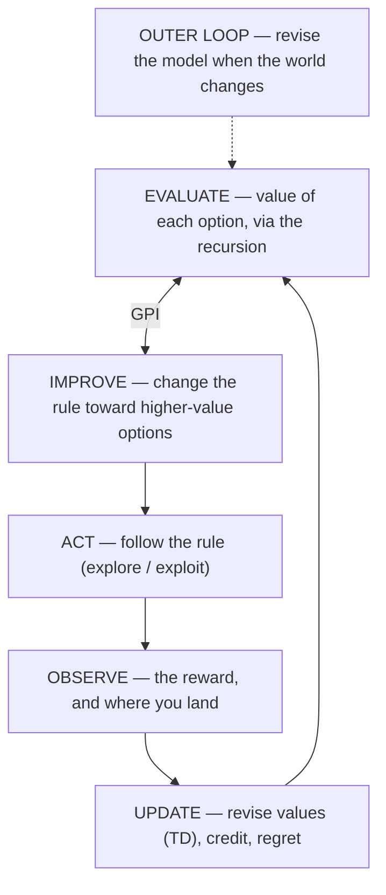

# RL Decision Framework (Human-Readable)

Use this for any personal decision whose value unfolds over time. It is a **loop over two things —
your value estimates and your rule of action — driven by a recursion.** The load-bearing pieces
are: a **value separate from the rule**, the **Bellman recursion**, a **learning update**, and
**iteration to a fixed point (GPI)**. The setting is a **POMDP, not an MDP**: you never see the
true state, only **observations** — you act on a **belief** about the state, revised as evidence
arrives, and some of what matters isn't just unseen but unmodeled (**unknown unknowns**).

The **global objective** is **Merton's**: maximize the expected **utility of consumption** over time
— discounted, and shaped by risk aversion — not raw reward, and not wealth.

## The loop

Run it in a loop. `EVALUATE ⇄ IMPROVE` (GPI) settles the rule; `ACT → OBSERVE → UPDATE` feeds it real
outcomes; the outer loop rebuilds the model when the world changes.

## Which RL stages live in which phase

| Phase | What you do | RL stages it consists of |
|---|---|---|
| **EVALUATE** | revise how much each situation/option is worth | STATE, REWARD, UTILITY, RETURN, VALUE, DISCOUNT, MODEL, HORIZON, RECURSION, RISK |
| **IMPROVE** | change the rule toward higher-value options | POLICY; GPI |
| **ACT** | follow the rule | ACTION; ACTION DISCOVERY; EXPLORE/EXPLOIT; SAMPLING; gates: RUIN, SAFETY, MULTIPLICATIVE |
| **OBSERVE** | see the result | OBSERVATION, REWARD, STATE |
| **UPDATE** | revise your estimates — values and beliefs | BELIEF UPDATE, LEARNING UPDATE (TD), CREDIT ASSIGNMENT, REGRET |
| **OUTER LOOP** | revise the model | NON-STATIONARITY, AMBIGUITY/ROBUSTNESS, UNKNOWN UNKNOWNS |

## Stages, defined

**STATE** — the situation you're in (resources, position, constraints). You rarely observe it fully,
so you act on a **BELIEF** (a picture of your state + its uncertainty). *"Where am I?"*

**OBSERVATION** — what you actually get to see: partial, noisy, sometimes delayed — a signal *about*
the state, never the state itself. *"What do I actually see?"*

**ACTION** — the choice you make. *"What can I do?"* The action set is itself part of the model:
it's rarely given, and you usually don't know what you don't know about it — treat the list of
options as a belief too, and let search and experience grow it. *"What can I even do — that I
haven't thought of?"*

**ACTION DISCOVERY** — finding actions that aren't in your list yet: asking how others solved this,
looking for the option everyone overlooks, noticing that "waiting" or "doing nothing" or "changing
the question" is also an action. The best move is often one you hadn't conceived. *"What options
exist outside my current list?"*

**REWARD** — the immediate payoff of an action — what you actually **consume** (experience),
valued through **utility**, not the raw number. *"What does it pay, now?"*

**UTILITY** ($U$) — the curve turning consumption into value: concave (diminishing returns) — that
curvature *is* your **risk aversion**; two units aren't worth twice one. *"How much does more
actually add?"*

**RETURN** ($G_t$) — the discounted sum of *all* future rewards — the total "tail." *"What is this
worth over the whole future?"*

**VALUE** ($V$, $Q$) — the *expected* return from a situation ($V$) or a situation-action pair ($Q$).
*"On average, what is this situation/option worth?"*

**DISCOUNT** ($\gamma$) — how much later rewards are down-weighted vs. now. *"How much do later
consequences count?"*

**MODEL** — your belief about how the world works: what leads to what (transitions), what pays
(rewards), and what observations to expect. *"What do I believe about how this works?"*

**BELIEF UPDATE (BAYES)** — after each observation, reweigh the pictures of the world: those that
predicted what you saw gain weight, those that didn't lose it. *"What does this sighting change?"*

**HORIZON / EPISODE** — whether it ends (finite: a goal/terminal state) or continues (infinite:
ongoing). *"Is there an end?"*

**POLICY** ($\pi$) — your rule mapping situations to actions. *"What's my standing rule?"*

**GPI (Generalized Policy Iteration)** — the loop that alternates two steps: **POLICY EVALUATION**
(compute the value of the current rule, via the recursion) and **POLICY IMPROVEMENT** (change the
rule toward higher-value actions) — repeated until the rule stops changing. *"Revise values ⇄ improve
the rule, until it settles."*

**EXPLORE vs EXPLOIT** — use what you know is good (**exploit**), or try something untested to learn
(**explore**). *"Known, or untested?"*

**SAMPLING (Thompson)** — draw a plausible version of "what's true," then act best in it; practically,
give the promising-but-untested a chance. *"Sample a world; act best in it."*

**PLANNING** — computing values/actions using your MODEL (imagining) rather than learning only from
real experience. *"Can I test it cheaply / simulate?"*

**LEARNING UPDATE (TD)** — revising your value estimate from the observed outcome:
$value(now) \leftarrow reward + \gamma\cdot value(next)$. *"Update from what happened."*

**CREDIT ASSIGNMENT** — working out which past decision actually caused a (delayed) outcome.
*"Which of my choices caused this?"*

**REGRET** — the gap between what you got and the best alternative you could have taken. *"How does
this compare to my best option?"*

**RISK** — the *distribution* of outcomes, not just the average. *"What's the range, especially the
bad tail?"*

**RUIN / TERMINAL / ABSORBING** — outcomes you can't recover from (the game ends). *"Can this end the
game?"*

**SAFETY / CONSTRAINTS** — rules you won't break regardless of reward. *"What's off-limits?"*

**OBJECTIVE** — the global target: **Merton's expected utility of consumption** — the discounted
utility of what you consume/experience over your life (plus any terminal value), not raw reward or
wealth. The binding failure is getting this wrong, not computing it poorly. *"Am I maximizing the
right thing?"*

**MULTIPLICATIVE / ERGODIC** — when outcomes compound, a loss shrinks the base for everything after;
judge the **typical** path you'll live, not the average over imaginary lives. *"Does it compound?"*

**NON-STATIONARITY** — the rules of the world drift, so the model must be revised. *"Has the world
changed?"*

**AMBIGUITY / ROBUSTNESS** — you may not even know the right model; prefer choices that survive being
wrong. *"What if my model is wrong?"*

**UNKNOWN UNKNOWNS** — factors your model doesn't even name; you can't price what you can't conceive.
You can't list them in advance — leave margin, probe cheaply, and read every surprise as evidence of a
missing variable. *"What am I not even asking about?"*

## The recursion (the engine)

> **value(here) = reward now + (how much later counts) × value(where it leads)**

You never sum the whole future — you **revise**: use your current estimate of the *next* situation's
value to update this one's (same rule, one step ahead), and repeat until it settles.

- **Finite horizon / an end exists**: it's a **recursion** — start at the end (base case), work backward.
- **Infinite horizon / ongoing**: it's a **fixed point** — no base case, so revise until values stop changing.

## The hard gates (override the loop)

- **RUIN** — if it can end the game, stop or use only what you can lose and keep playing.
- **SAFETY** — off-limits, whatever the reward.
- **MULTIPLICATIVE** — judge the typical path; size as a fraction, never all-in.

## Caveats (human)

- **Start with OBJECTIVE** — the binding human failure is a *wrong goal*, not a hard computation.
  The global target is **Merton's**: expected **utility of consumption**, not raw reward or wealth.
- **You can't compute value functions exactly.** You **approximate** — sample, imagine a few
  rollouts, revise a few estimates. The framework is a **scaffold for comparing consequences and
  assigning credit — not a promise of optimality.**
- **PARTIAL OBSERVABILITY is the default (POMDP)** — you never see the true state, only observations.
  Act on your **belief**, update it from evidence, and remember your values are values-*of-belief*:
  the recursion runs on what you think is true. **Unknown unknowns** aren't in the model at all — you
  can't price them, so leave margin, probe cheaply, and treat every surprise as evidence of a missing
  variable.

## Usage
Loop **EVALUATE ⇄ IMPROVE** (GPI) until the rule settles, fed by **ACT → OBSERVE → UPDATE**. Run the
**recursion** at EVALUATE. **RUIN**, **SAFETY**, **MULTIPLICATIVE** are hard gates every pass. Start at
**OBJECTIVE**. Take the **OUTER LOOP** when reality contradicts the model.

The output is the **settled policy** — a standing rule (*"in situation X, do Y"*) — not a one-off
action. Report it as a rule so it generalizes beyond the single case in front of you.

## Worked example (Merton consumption)

**Scenario.** Age 35, $500k invested, retiring at 65 (30 years). Each year choose (a) how much
wealth to consume and (b) the fraction of the portfolio in a risky equity index vs. safe bonds.
Maximize expected discounted CRRA utility of lifetime consumption; ruin (wealth → 0) is absorbing.

**Parameters.** γ = 3 (CRRA), β = 0.96 (time preference), r_f = 1% (safe real), risky asset
+25% / −15% (50/50 → mean 5%, vol ~20%). Wealth grid $0–$3M (601 pts), consumption fraction 0–100%
(51 pts), risky share 0–100% (21 pts).

**The recursion.** Terminal value V_T(W) = u(W) (consume all at retirement), then work backward:

> V_t(W) = max over c, α of [ u(c) + β · E V_{t+1}( (W−c)(1 + (1−α)r_f + α r) ) ],  u(c) = c^(1−γ)/(1−γ)

**Results.**
- Optimal at t=0, W=$500k: **consume 4.0% ($20k/yr), risky share 35%.**
- Consumption rises as the end nears (same $500k): 4% at 35 → 6% at 45 → 10% at 55 → 50% at 64.
- Value is concave: V($100k)=−0.844, V($500k)=−0.022, V($1M)=−0.005, V($2M)=−0.001.
- vs. naive "all-in equities, spend 5%": expected discounted utility **−0.086 vs −0.022** —
  over-betting a good edge still costs utility.
- **Fixed point:** infinite-horizon value iteration converges after **~690 sweeps** (max|ΔV| < 1e−6).

**Ruin gate.** A bet with a 10% annual chance of total loss (else +25%):
  all-in (f=1) → **~96% ruin** (0.9³⁰ = 4% survival); f=0.3 → **0% ruin**, median wealth ×2.4.
Sizing as a fraction survives; all-in ends the game.

**POMDP / belief.** Unknown regime, prior P(good)=0.5; an up year → 0.64, a down year → 0.33.
Optimal risky share: **100%** if known-good, **0%** if known-bad, **40%** acting on the belief —
hedged, not boldest. A third, unnamed regime would break all three (unknown unknowns → margin +
outer loop).

Reproducible: `example.py` (NumPy value iteration + Monte Carlo).

## Source Integrity Rules
- Use `ai_venice_web_search` when the decision depends on external facts.
- If `ai_venice_web_search` is rate-limited (429) or unavailable, immediately use `websearch` (Exa) instead — do not retry.
- NEVER fabricate URLs, citations, or sources — only cite what search returns.

## Agent Rules
1. Treat it as a loop over **values and policies** (EVALUATE ⇄ IMPROVE) — not observe→decide→act.
   The deliverable is the **policy**: a standing rule (*"in situation X, do Y"*), not a single action.
2. At EVALUATE, use the **recursion** (`value = reward + γ·value(next)`), revising until it settles.
3. Force the **RUIN** and **SAFETY** gates before recommending any option; size as a fraction.
4. Start with **OBJECTIVE**; state the **belief** (you don't fully observe the state).
5. Take the **OUTER LOOP** when the model is contradicted.
6. Treat the setting as a **POMDP**: act on the stated **belief**, update it from every observation,
   and treat surprises as evidence of **unknown unknowns**.
7. Treat the **action set as a belief too** — before recommending an option, ask whether better
   unconsidered actions exist (**ACTION DISCOVERY**), including doing nothing or reframing the goal.
